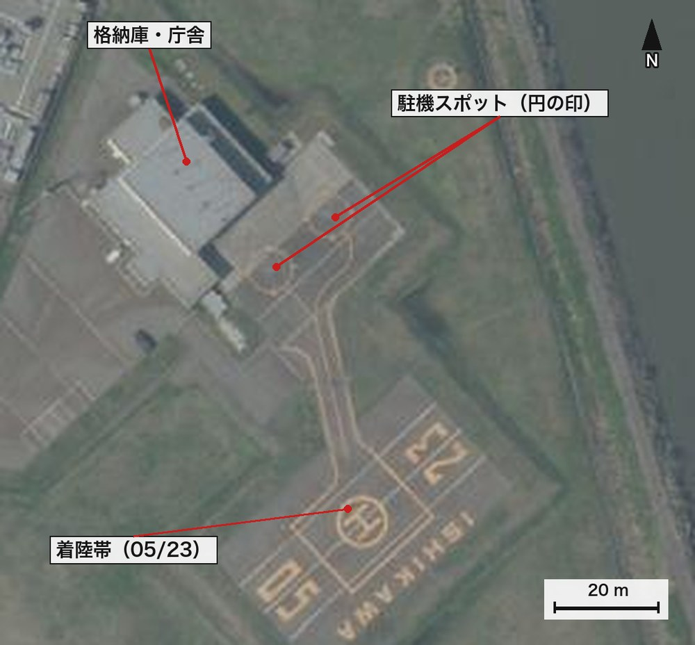

2026年11月16日の午後、金沢市の石川県警察航空隊ヘリポートで、<strong>兵庫県警のヘリコプターの回転翼が格納庫の外壁に当たりました</strong>。けが人はいません。

エンジンの故障でも、悪天候でもありません。止まっている建物に、ゆっくり当たった事故です。起きたあとで聞くと「なぜ避けられなかったのか」と不思議に思えます。

ただ、この形の事故は、調べると<strong>50年前から何度も同じ形で起きています</strong>。今回はそれを並べて、なぜ繰り返すのかを考えます。

先に断っておくと、原因はまだ公表されていません。ここから先の分析は、報道と公開資料にもとづく筆者の見方です。

## 何が起きたか

報道（北陸放送、11月17日配信）で分かっていることは次のとおりです。

| 項目 | 内容 |
|---|---|
| 日時 | 2026年11月16日 午後2時前 |
| 場所 | 石川県警察航空隊ヘリポート（金沢市湊1丁目） |
| 機体 | 兵庫県警のヘリコプター「フェニックス」（機種は報道に出ていない） |
| 搭乗者 | 操縦士と整備士あわせて4人。けが人なし |
| 状況 | 翌17日に輪島市を視察する警察庁長官らを乗せる予定で、<strong>その下見に離陸しようと方向転換した際</strong>に接触 |
| 損傷 | 格納庫の外壁に<strong>長さ約3m、幅約50cm</strong>のえぐられたような傷。「プロペラの先端部」が損傷 |

兵庫県警の機体にとって、ここは<strong>自分の基地ではないヘリポート</strong>です。

11月28日の時点で、運輸安全委員会のサイトには、この件の調査開始の情報は見当たりませんでした。

## 写真の傷から読めること

報道に出ている壁の写真を見ると、傷は<strong>壁の高いところに、横に長く</strong>えぐれています。

最初は、テールローター（尾部ローター）が当たったのではないかと疑いました。機首を回すときに尾部は操縦士の後ろで円を描くので、いちばん見えない部分だからです。

ただ、テールローターは縦に回っています。当たると、傷は縦の短い切れ込みになりやすいはずです。<strong>横に3mも続く傷は、水平に回るメインローターの先端が掃いた跡</strong>と見るほうが自然です。記事の「プロペラの先端部が損傷」という書き方とも合います。

これが正しければ、問題は「尾部が見えなかった」ことではありません。<strong>メインローターの円そのものが、壁に届く位置まで来ていた</strong>ことになります。

## ヘリポートの配置

国土地理院の航空写真で、このヘリポートを見てみます。

*出典：国土地理院 シームレス空中写真（撮影時期は不明。現況と異なる可能性があります）。注記は筆者が加えました。*

格納庫・庁舎の前にエプロンがあり、<strong>円の印の駐機スポットが二つ</strong>、建物に寄り添うように並んでいます。そこから誘導路が延びて、05/23の着陸帯につながっています。

写真から概算すると、駐機スポットの中心から建物の正面までは<strong>十数メートル程度</strong>です。写真の撮影時期は分からず、当たった壁がどの面なのかも報道からは特定できないので、あくまで目安です。

一方、中型の双発ヘリは、機種にもよりますが、<strong>メインローターの半径がおおよそ5.5〜7m</strong>、<strong>マストから尾部の先までがおおよそ7.5〜10m</strong>です。

十数メートルの位置で、マストを動かさずにその場で回るなら、ぶつかりません。ただ、<strong>余裕は数メートルしかありません</strong>。

## なぜ当たるのか——回る「中心」がずれる

ヘリをその場で回すとき、私たちは「マストを中心に回っている」つもりでいます。ところが、実際には中心がずれることがあります。

<figure style="margin:1.5em 0;">
<svg viewBox="0 0 680 390" xmlns="http://www.w3.org/2000/svg" style="width:100%;height:auto;font-family:sans-serif;" role="img" aria-label="マストを中心に回る場合と、操縦席を中心に回ってしまう場合の比較">
<defs><marker id="hsArr" markerWidth="10" markerHeight="10" refX="9" refY="5" orient="auto"><path d="M0,0 L10,5 L0,10 z" fill="#c0392b"/></marker></defs>
<text x="170" y="24" font-size="15" font-weight="bold" text-anchor="middle" fill="#222">① マストを中心に回る</text>
<rect x="20" y="40" width="300" height="18" fill="#7b8794"/>
<text x="170" y="54" font-size="12" text-anchor="middle" fill="#fff">格納庫の壁</text>
<circle cx="170" cy="215" r="75" fill="#2c6fbb" fill-opacity="0.08" stroke="#2c6fbb" stroke-width="2" stroke-dasharray="6 4"/>
<circle cx="170" cy="215" r="110" fill="none" stroke="#c0392b" stroke-width="1.5" stroke-dasharray="2 4"/>
<ellipse cx="170" cy="205" rx="15" ry="34" fill="#555"/>
<line x1="170" y1="235" x2="170" y2="322" stroke="#555" stroke-width="5"/>
<line x1="163" y1="324" x2="177" y2="324" stroke="#555" stroke-width="4"/>
<circle cx="170" cy="215" r="4" fill="#fff" stroke="#222" stroke-width="2"/>
<text x="180" y="219" font-size="11" fill="#222">マスト</text>
<text x="252" y="150" font-size="12" fill="#2c6fbb">主ローターの円</text>
<text x="232" y="318" font-size="12" fill="#c0392b">尾部が描く円</text>
<text x="170" y="355" font-size="12.5" text-anchor="middle" fill="#222">主ローターの円は動かない。</text>
<text x="170" y="373" font-size="12.5" text-anchor="middle" fill="#222">広さを決めるのは、より大きい尾部の円</text>
<line x1="340" y1="10" x2="340" y2="380" stroke="#ccc" stroke-width="1"/>
<text x="510" y="24" font-size="15" font-weight="bold" text-anchor="middle" fill="#222">② 操縦席を中心に回ってしまう</text>
<rect x="360" y="40" width="300" height="18" fill="#7b8794"/>
<text x="420" y="54" font-size="12" text-anchor="middle" fill="#fff">格納庫の壁</text>
<circle cx="510" cy="215" r="75" fill="none" stroke="#999" stroke-width="1.5" stroke-dasharray="6 4"/>
<ellipse cx="510" cy="197" rx="15" ry="40" fill="#aaa"/>
<line x1="510" y1="235" x2="510" y2="322" stroke="#aaa" stroke-width="5"/>
<line x1="503" y1="324" x2="517" y2="324" stroke="#aaa" stroke-width="4"/>
<circle cx="510" cy="130" r="75" fill="#c0392b" fill-opacity="0.08" stroke="#c0392b" stroke-width="2" stroke-dasharray="6 4"/>
<circle cx="510" cy="215" r="4" fill="#fff" stroke="#777" stroke-width="2"/>
<circle cx="510" cy="130" r="4" fill="#fff" stroke="#c0392b" stroke-width="2"/>
<line x1="510" y1="209" x2="510" y2="140" stroke="#c0392b" stroke-width="2.5" marker-end="url(#hsArr)"/>
<circle cx="510" cy="172" r="6" fill="#f1c40f" stroke="#222" stroke-width="1.5"/>
<line x1="517" y1="172" x2="580" y2="172" stroke="#222" stroke-width="1"/>
<text x="584" y="168" font-size="11.5" fill="#222">回る中心が</text>
<text x="584" y="183" font-size="11.5" fill="#222">操縦席にある</text>
<text x="408" y="108" font-size="11.5" fill="#c0392b">半周後の</text>
<text x="408" y="123" font-size="11.5" fill="#c0392b">主ローターの円</text>
<text x="522" y="236" font-size="11" fill="#777">回る前のマスト</text>
<path d="M500,58 l10,-10 l10,10 l-10,10 z" fill="#c0392b"/>
<text x="528" y="78" font-size="12" font-weight="bold" fill="#c0392b">接触</text>
<text x="510" y="355" font-size="12.5" text-anchor="middle" fill="#222">マストが、操縦席〜マストの距離の</text>
<text x="510" y="373" font-size="12.5" text-anchor="middle" fill="#222">2倍だけ壁側へ動く</text>
</svg>
<figcaption style="font-size:0.85em;color:#666;text-align:center;">その場で向きを変えるとき、回る中心がどこにあるかで、ローターの届く範囲が変わる（筆者作成の概念図。寸法は実際のものではありません）</figcaption>
</figure>

図の①のように、<strong>マストを中心に回るなら、主ローターの円は動きません</strong>。必要な広さを決めるのは、主ローターより大きい尾部の円です。

ところが、操縦士は機首の先や自分の座席の位置で、外の目標を見ながら回します。図の②のように<strong>回る中心が操縦席のあたりにあると、マストそのものが弧を描いて動きます</strong>。半周回れば、マストは「操縦席からマストまでの距離」の2倍だけ移動します。主ローターの円は、そのぶん丸ごと壁側へ寄ります。

車輪式の機体が地上で向きを変える場合も同じです。片側の車輪を軸にして回れば、マストはやはり弧を描きます。

これに、ホバリング中の<strong>流れ</strong>（風や操作で機体が横にずれること）が重なります。後で紹介する1977年の事例では、回っている間に機体が<strong>約3m</strong>流れていました。

数メートルしか余裕がない場所で、この二つが重なれば、ローターは壁に届きます。

## 50年前から、同じ形で起きている

運輸安全委員会（旧・航空事故調査委員会）の報告書を探すと、同じ形の事故がいくつも出てきます。

| 年 | 機体 | 場所 | 何が起きたか |
|---|---|---|---|
| 1976年7月 | ベル47（JA7475） | 宮崎県・町役場の敷地内広場 | ホバリングで移動中、<strong>メインローターを車庫の屋根に接触</strong>。原因は障害物との間隔の目測誤り |
| 1976年10月 | アルウェットII（JA9002） | 調布空港・格納庫前エプロン | ホバリングで右に回った際、<strong>尾部を格納庫の扉に接触</strong> |
| 1977年5月 | ベル204B（JA9021） | 栃木県・臨時ヘリポート | 180度向きを変えるホバリングターン中、<strong>テールローターが杉の木に接触</strong>して不時着 |

1976年の調布の報告書には、所見として「回転翼航空機の地表近くにおけるホバリング及び移動に際しては、建築物、その他の物件との接触防止について、十分な対策を講ずる必要がある」と書かれています。さらに同種の事故例として、1974年から1976年の3件（JA9128、JA9505、JA7475）が挙げられています。

<strong>わずか2年ほどの間に、同じ形の事故が4件</strong>です。その後も形を変えて続いていて、今回の金沢の件もその延長にあるように見えます。

### 1977年・栃木：前の建物を見ていて、後ろの木に当てた

栃木の事例は、今回を考えるうえで特に示唆的です。

機長は、翌日の風を考えて機首を反対に向けておこうと、板張りの係留地でホバリングターンを始めました。係留地のそばには、前方に事務所の建物、後方に高さ約10mの杉の木がありました。

報告書の解析はこうです。マストを係留地の中心に置いて回れば、テールローターと杉の木の間は約3mありました。機長は<strong>前方の建物との間隔に注意を払いながら回り</strong>、後方の杉の木は「十分余裕がある」と判断して気にかけていなかった、と推定されています。その間に機体が<strong>東へ約3m移動</strong>し、テールローターが杉に当たりました。

<strong>見えている障害物に注意が向き、見えていない側の余裕を食いつぶした</strong>、という構図です。

## 誘導員がいれば防げるか

この種の事故の対策として、真っ先に挙がるのは「誘導員をつける」です。

ただ、私はそれだけでは防げないと思っています。<strong>ぶつける人は、そういうのを見ていない</strong>からです。それを裏付ける報告書がありました。1976年の調布の事例です。

このとき、エプロンには<strong>地上誘導員がいました</strong>。

1. 誘導員は、機体が格納庫の扉に近づきすぎていると判断し、「右へ横に移動せよ」の手信号を送りました。
2. 機長はこれを「<strong>右に回れ</strong>」の指示と受け取り、右にホバリングで回りました。
3. 誘導員は、今度はメインローターが扉に当たりそうだと見て、もう一度「右へ横に移動せよ」を送りました。
4. 機長はまた「右に回って着陸せよ」と受け取り、さらに右に回りました。そして、尾部が扉に当たりました。

報告書は原因を、手信号の誤判断と、扉までの目測が十分でなかったこと、と結論しています。

誘導員はちゃんと危険を見ていて、正しい合図を2回送っています。それでも防げませんでした。

<strong>操縦士の目と頭が「狭い場所で機体を収めること」で埋まっているとき、外からの合図は、届かないか、自分の思い込みに沿って読み替えられてしまいます</strong>。誘導員は、操縦士がそれを見て、正しく読める余裕があるときにしか機能しません。そして事故が起きるのは、まさにその余裕がないときです。

だとすると、対策は「外の誰かが止めてくれる」ことに頼らない形にする必要があります。

## 対策：その場で回らない、回る場所を決めておく

ここからは筆者の考えです。

### 1. 障害物のそばでは、その場で回らない

格納庫や建物に近い場所では、<strong>向きを変えずに、まっすぐ離れる</strong>。開けた場所、たとえば着陸帯の上まで出てから回します。

今回のヘリポートで言えば、エプロンのスポットから、誘導路沿いに着陸帯まで出て、そこで向きを変えれば、周りに建物はありません。

「回すのは着陸帯の上だけ」と決めてしまえば、余裕を目測する必要そのものがなくなります。

### 2. 回る前に、回る中心と向きを決める

どうしても狭い場所で回すなら、回り始める前に決めておきます。

- <strong>マストを地面のどの印の上に置いたまま回るか</strong>。自分の座席ではなく、マストを中心にする
- <strong>どちら回りにするか</strong>。尾部とローターが障害物から離れる側に回す
- <strong>途中で止める条件</strong>。たとえば「機体が流れ始めたら、いったん止めて位置を直す」

回り始めてから考えるのでは間に合いません。そのときには、目はもう外の目標に張り付いています。

### 3. 受け入れる側から、寸法を渡す

よその機体を受け入れるヘリポートは、紙1枚でいいので、次の情報を先に渡しておくと効果があると思います。

- スポットの中心から、建物までの距離
- そのスポットで、その場で回ってよい機体の大きさ
- 向きを変えてよい場所（たとえば「着陸帯の上でのみ」）

自分の基地なら、どこまで回せるかが体に入っています。<strong>よそから来た機体は、その「感覚の物差し」を持っていません</strong>。物差しを、言葉と数字で渡すしかありません。

### 4. 地面に描く

可能なら、スポットに<strong>「この円の中で回れる機体の大きさ」</strong>を描いておきます。操縦士は、狭い場所では外の目標を見ながら操縦しています。地面に描いた線は、その視線の中に入ります。手信号よりも、見落とされにくいはずです。

### 5. 迷ったら、エンジンを止めて押す

間隔に少しでも自信がなければ、その場では回さず、いったん着陸してエンジンを止め、地上で押して向きを変えます。時間はかかりますが、確実です。

今回は、翌日に長官を乗せるための下見でした。「明日のために、今日のうちに済ませたい」という気持ちと、慣れない場所での作業が重なっていました。こういう日ほど、手間のかかる方法を選べる決まりがあると助かると思います。

## 今回の件で確かめたいこと

調査が進んだら、次の点が分かると、今回の見立てが正しいかどうかを答え合わせできます。

- 当たったのはメインローターかテールローターか。傷の高さはどれくらいか
- 機種は何か。スキッド式か車輪式か。地上で回ったのか、ホバリングで回ったのか
- どのスポットから、どちら回りで回ったのか
- 回っている間に、機体はどれだけ動いたか
- 誘導員はいたか。いたなら、合図はどう伝わったか
- 受け入れ側から、スポットや回ってよい場所の説明はあったか
- そのときの風

## まとめ

- 2026年11月16日、金沢市の石川県警察航空隊ヘリポートで、兵庫県警のヘリが離陸のため方向転換した際、回転翼を格納庫の外壁に当てた。けが人はなし。翌日の警察庁長官の視察に向けた下見の直前だった。
- 報道写真の傷は<strong>壁の高いところに横に長く</strong>、メインローターの先端が当たった可能性が高いと筆者は見ている。
- 地理院の航空写真では、駐機スポットは建物に寄り添うように置かれ、中型双発機がその場で回るには<strong>余裕は数メートル</strong>しかない（写真からの概算）。
- 回る中心が<strong>マストから操縦席側へずれる</strong>と、主ローターの円ごと壁側へ寄る。ホバリング中の流れが重なれば、さらに近づく。
- 同じ形の事故は1970年代から繰り返されている。1976年の調布では、<strong>誘導員が正しい合図を2回送っても</strong>、機長はそれを「回れ」と読み違えて尾部を当てた。
- だから対策は、外の人に頼らない形にしたい。<strong>障害物のそばでは回らず、開けた場所まで出てから回す</strong>。回るなら、回り始める前に中心と向きを決める。受け入れ側は、寸法と「回ってよい場所」を先に渡す。

### 関連記事

- [取水直後に機首から川へ——ボルネオのEC225墜落と、『見えない場所』から水をくむときの離れ方](/blog/borneo-ec225-bucket-crash-2026/)

---

*本記事は、報道および運輸安全委員会の公開資料をもとに、現役ヘリコプターパイロットの視点から整理したものです。今回の事故の原因は調査中で、傷の読み取り、ヘリポートの寸法の概算、回る中心のずれに関する説明は、いずれも筆者の見方です。公式の調査結果ではありません。*

*ヒーロー画像は、格納庫の前に駐機する北海道警察のベル412EP「だいせつ3号」です。今回の事故の機体ではありません。"Bell412EP hokkaido police Daisetsu 3" by 100yen / [Wikimedia Commons](https://commons.wikimedia.org/wiki/File:Bell412EP_hokkaido_police_Daisetsu_3.JPG) / CC BY-SA 3.0（本記事への掲載にあたりリサイズを行いました）*

---

<strong>出典</strong>

- 北陸放送「兵庫県警ヘリの回転翼が石川県警のヘリポート格納庫に接触 けが人なし 警察庁長官ら搭乗予定で来県」（2026年11月17日配信、Yahoo!ニュース） [https://news.yahoo.co.jp/articles/b427678a4a49712a059d39e6d4c446bd40d7f0aa](https://news.yahoo.co.jp/articles/b427678a4a49712a059d39e6d4c446bd40d7f0aa)／写真 [https://newsdig.tbs.co.jp/articles/gallery/3091311](https://newsdig.tbs.co.jp/articles/gallery/3091311)
- 国土地理院 地理院タイル（シームレス空中写真）
- 航空事故調査委員会「東邦航空株式会社所属シュド式SE3130アルウェットII型JA9002に関する航空事故報告書」（昭和52年3月1日議決） [https://jtsb.mlit.go.jp/aircraft/rep-acci/52-2-JA9002.pdf](https://jtsb.mlit.go.jp/aircraft/rep-acci/52-2-JA9002.pdf)
- 航空事故調査委員会「朝日ヘリコプター株式会社所属富士ベル式204-B型JA9021に関する航空事故報告書」（昭和53年2月23日議決） [https://jtsb.mlit.go.jp/aircraft/rep-acci/53-3-JA9021.pdf](https://jtsb.mlit.go.jp/aircraft/rep-acci/53-3-JA9021.pdf)
- 航空事故調査委員会「大阪エアウエーズ株式会社所属川崎ベル式47G3B-KH4型JA7475に関する航空事故報告書」（昭和51年9月30日） [https://jtsb.mlit.go.jp/aircraft/rep-acci/51-7-JA7475.pdf](https://jtsb.mlit.go.jp/aircraft/rep-acci/51-7-JA7475.pdf)
